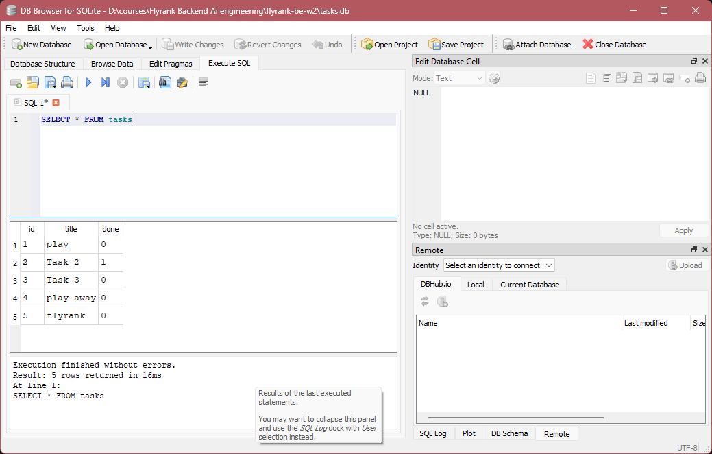

# Task Management API

A simple RESTful Task Management API built with **FastAPI** and **SQLite**. It supports creating, retrieving, updating, and deleting tasks, with request validation using Pydantic.

## Features

- Create a task with a validated title.
- Retrieve all tasks or a specific task by ID.
- Partially update a task's title or completion status.
- Delete a task.
- Validate incoming request data using Pydantic.
- Manage database connections through FastAPI dependency injection.
- Return appropriate HTTP status codes and error responses.

## Tech Stack

| Technology | Purpose |
|---|---|
| Python | Main programming language |
| FastAPI | REST API framework |
| SQLite | Relational database |
| Pydantic | Request validation |
| Uvicorn | ASGI server |

SQLite is used because it is lightweight, serverless, and doesn't require a separate database server or configuration. It is suitable for this small project.

## Project Structure

```text
flyrank-be-w2/
├── app/
│   ├── database/
│   │   └── db.py
│   └── main.py
├── images/
├── .gitignore
├── README.md
├── requirements.txt
├── tasks.db
└── .venv/
```

## Getting Started

### 1. Clone the repository

```bash
git clone <repository-url>
cd flyrank-be-w2
```

### 2. Create and activate a virtual environment

```bash
python -m venv .venv
```

Windows:

```bash
.venv\Scripts\activate
```

### 3. Install dependencies

Install all required packages from `requirements.txt`:

```bash
pip install -r requirements.txt
```

SQLite is included with Python, so no separate database installation is required.

### 4. Start the API

```bash
python -m fastapi dev main.py
```

The database is initialized automatically when the application starts. If the database or `tasks` table doesn't exist, it will be created automatically.

The API will be available at:

```text
http://127.0.0.1:8000
```

### 5. Explore the API documentation

Open Swagger UI in your browser:

```text
http://127.0.0.1:8000/docs
```

You can explore and test all available endpoints directly from the interactive documentation.

## API Endpoints

| Method | Endpoint | Description |
|---|---|---|
| GET | `/` | API information |
| GET | `/health` | Health check |
| GET | `/tasks` | Retrieve all tasks |
| GET | `/tasks/{id}` | Retrieve a task by ID |
| POST | `/tasks` | Create a new task |
| PATCH | `/tasks/{id}` | Partially update a task |
| DELETE | `/tasks/{id}` | Delete a task |

## Example Requests

### Create a task

`POST /tasks`

```json
{
  "title": "Learn FastAPI"
}
```

### Update a task

`PATCH /tasks/1`

```json
{
  "done": true
}
```

### Delete a task

`DELETE /tasks/1`

## Database Design

The application uses a SQLite database named `tasks.db`.

The `tasks` table contains:

| Column | Type | Description |
|---|---|---|
| id | INTEGER | Primary key, auto-incremented |
| title | TEXT | Task title, required |
| done | INTEGER | Completion status (0 or 1) |

The `done` column has a default value of `0` and a CHECK constraint to ensure it only stores `0` or `1`.

### Example SQL Query

Retrieve all tasks:

```sql
SELECT * FROM tasks;
```

Retrieve only completed tasks:

```sql
SELECT * FROM tasks WHERE done = 1;
```

### Inspecting the Database

You can open `tasks.db` using a SQLite database viewer, such as the SQLite Viewer extension in VS Code, to inspect the database, browse records, and execute SQL queries.

<!-- Optional: Add a screenshot of the database viewer here -->


## Request Validation

Pydantic models validate incoming request bodies.

- `TaskCreate` ensures the title is not empty or whitespace.
- `TaskUpdate` validates the title when it is provided.
- Invalid request data is rejected before it reaches the database operations.

## Database Connection Management

The application uses FastAPI's dependency injection system with a generator dependency.

Each request that needs database access obtains a connection and cursor. The connection is closed automatically after the request finishes, including when an exception occurs.

## Interactive API Documentation

FastAPI automatically generates interactive API documentation.

- Swagger UI: `http://127.0.0.1:8000/docs`
- ReDoc: `http://127.0.0.1:8000/redoc`

These interfaces allow you to explore endpoints and test requests directly from your browser.