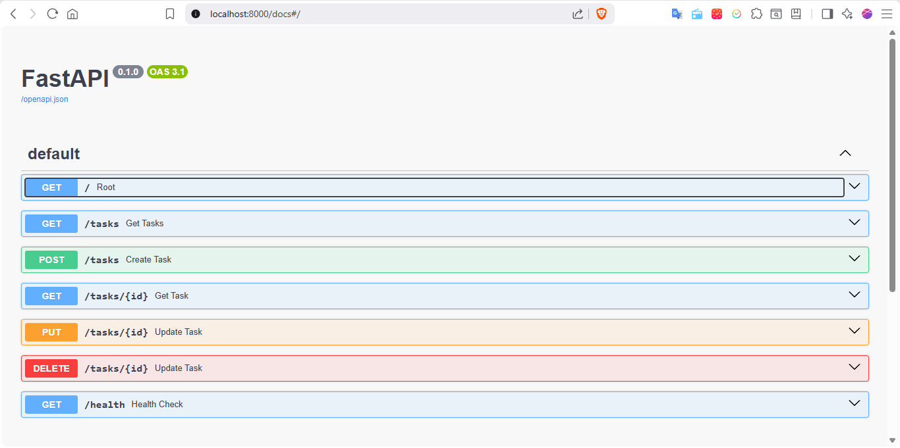
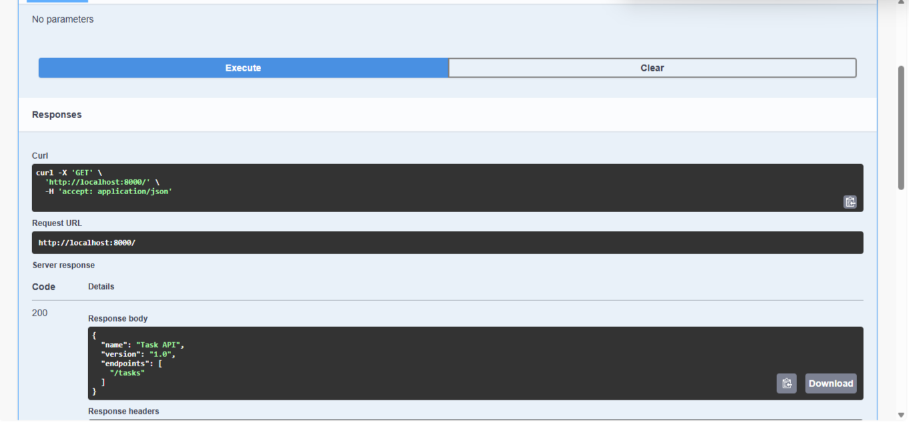
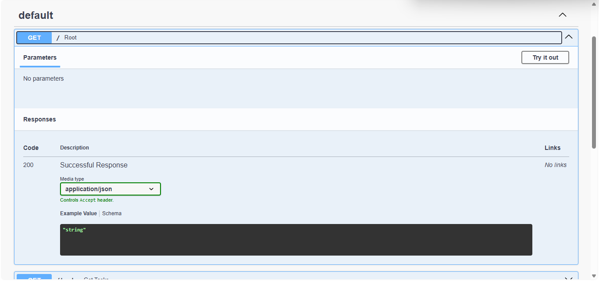

# W2 · A1 — Build your first CRUD API

A simple RESTful Task API built with **FastAPI**. It allows you to create, read, update, and delete tasks (CRUD). The API also provides interactive documentation through Swagger UI.

## Features

* Create a new task
* Retrieve all tasks
* Retrieve a task by ID
* Update an existing task
* Delete a task
* Automatic interactive API documentation with Swagger UI

## Requirements

* Python 3.10+
* FastAPI
* Uvicorn/FastAPI CLI

## Installation & Run

1. Install the required packages.

2. Start the development server:

```bash
python -m fastapi dev main.py
```

The API will be available at:

* API: http://127.0.0.1:8000
* Swagger UI: http://127.0.0.1:8000/docs

## API Endpoints

| Method | Endpoint      | Description                                     |
| ------ | ------------- | ----------------------------------------------- |
| GET    | `/`           | Returns API information                         |
| GET    | `/tasks`      | Returns all tasks                               |
| GET    | `/tasks/{id}` | Returns a task by its ID                        |
| POST   | `/tasks`      | Creates a new task                              |
| PUT    | `/tasks/{id}` | Updates a task's title and/or completion status |
| DELETE | `/tasks/{id}` | Deletes a task                                  |
| GET    | `/health`     | Health check endpoint                           |

## Example Request

```bash
curl.exe -i -X POST "http://127.0.0.1:8000/tasks" -H "Content-Type: application/json" -d '{"title":"Buy milk"}'
```

## Example Response

```text
HTTP/1.1 201 Created
content-type: application/json

{
  "id": 4,
  "title": "Buy milk",
  "done": false
}
```

## Swagger UI

FastAPI automatically generates interactive API documentation.

Open:

```
http://127.0.0.1:8000/docs
```

You can use **Try it out** to create, retrieve, update, and delete tasks directly from the browser.

### Screenshots






## Project Structure

```text
.
├── main.py
├── README.md
└── images
    └── swagger-ui.png
```

## Author

Created as part of a FastAPI REST API assignment.